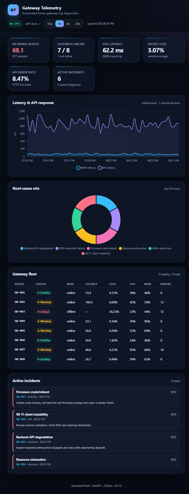
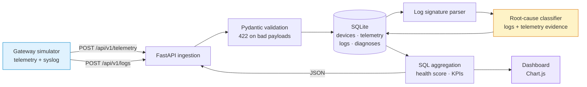

# Automated Home Gateway Telemetry & Log Diagnostic Dashboard

An end-to-end **telemetry simulator, log-diagnostic pipeline, REST API and
monitoring dashboard** for simulated home network gateways.

The project models the full device-to-backend loop: gateways emit telemetry and
syslog lines, the API validates and stores them in SQLite, a rule-based engine
extracts network failure signatures and classifies root causes, and an
interactive dashboard visualises the SQL aggregates.




---

## What it demonstrates

| Capability | Implementation |
|---|---|
| Device telemetry simulation | Deterministic fleet simulator with per-device fault profiles (`simulator.py`) |
| Log parsing & signature extraction | Regex signature library mapping syslog messages to failure codes (`log_parser.py`) |
| Root-cause classification | Weighted evidence model combining logs + telemetry (`diagnostics.py`) |
| REST API | FastAPI + Pydantic schemas, correct status codes, OpenAPI docs (`api.py`) |
| SQL analytics | Parameterised SQLite aggregation queries incl. a composite health score (`repository.py`, `sql/`) |
| Automated testing | 48 pytest tests: schemas, status codes, parser, classifier, SQL, simulator determinism |
| Interactive dashboard | Chart.js UI polling the metrics endpoints (`dashboard/`) |

## Architecture



## Quickstart

Requires Python 3.10+.

```powershell
py -m venv .venv
.\.venv\Scripts\Activate.ps1
pip install -r requirements-dev.txt
pip install -e .

# Seed a deterministic demo fleet (8 gateways, 6 hours of data)
gateway-telemetry seed --devices 8 --hours 6 --reset

# Start the API + dashboard (auto-seeds if the DB is empty)
gateway-telemetry serve --port 8000
```

Open <http://127.0.0.1:8000> for the dashboard and
<http://127.0.0.1:8000/docs> for interactive OpenAPI documentation.

On macOS/Linux activate with `source .venv/bin/activate`.

### Live simulation

Stream new telemetry every few seconds and watch the dashboard update:

```powershell
gateway-telemetry simulate --devices 8 --interval 5
```

### Run diagnostics manually

```powershell
gateway-telemetry diagnose --window-minutes 120
```

```
Classified 8 devices -> 6 incident(s).
  GW-007: Firmware crash/reboot (critical, confidence 99%)
    evidence: FIRMWARE_CRASH x74
  GW-002: DNS resolution failure (critical, confidence 99%)
    evidence: DNS_RESOLVE_FAILED x71, TELEMETRY_DNS_LATENCY x1
  ...
```

## API

| Method | Endpoint | Purpose | Success |
|---|---|---|---|
| GET | `/health` | Liveness + version | 200 |
| POST | `/api/v1/telemetry` | Ingest a telemetry heartbeat | 201 / 422 |
| POST | `/api/v1/logs` | Parse + store a syslog line | 201 / 422 |
| GET | `/api/v1/devices` | Fleet state (latest sample per device) | 200 |
| GET | `/api/v1/devices/{device_id}` | One device | 200 / 404 |
| GET | `/api/v1/devices/{device_id}/telemetry` | Raw samples | 200 / 404 |
| GET | `/api/v1/devices/{device_id}/logs` | Recent parsed logs | 200 |
| GET | `/api/v1/metrics/overview` | KPIs + health score | 200 |
| GET | `/api/v1/metrics/timeseries` | 1-minute buckets | 200 |
| GET | `/api/v1/metrics/root-causes` | Incident distribution | 200 |
| POST | `/api/v1/diagnostics/run` | Run classifier, persist incidents | 200 |
| GET | `/api/v1/diagnostics` | Stored incidents | 200 |

Example ingestion:

```bash
curl -X POST http://127.0.0.1:8000/api/v1/telemetry \
  -H "Content-Type: application/json" \
  -d '{
    "device_id": "GW-900",
    "uptime_s": 7200,
    "cpu_pct": 24.5,
    "memory_pct": 41.2,
    "wan_status": "online",
    "latency_ms": 14.2,
    "packet_loss_pct": 0.1,
    "wifi_clients": 9,
    "tx_bytes": 12000,
    "rx_bytes": 88000,
    "api_latency_ms": 175,
    "http_status": 200
  }'
```

Full request/response reference: [`docs/api.md`](docs/api.md).

## Diagnostic engine

Each log line is parsed into structured fields and matched against an ordered
signature library. For example:

```text
2026-11-09T12:00:00Z [ERROR] dns: DNS resolution failed for api.vendor.net
```

→ signature `DNS_RESOLVE_FAILED`, category `dns`, root cause
**DNS resolution failure**.

Evidence is weighted by signature weight × severity multiplier
(`INFO 0.2`, `WARN 1.0`, `ERROR 2.0`, `CRITICAL 3.0`). Telemetry adds its own
evidence — WAN offline ratio, packet loss, memory/CPU pressure, API latency and
5xx ratio, DNS latency, Wi-Fi signal quality.

The highest-scoring root cause wins. Confidence combines evidence dominance and
volume:

```text
share      = top_score / total_score
volume     = min(1, top_score / 5)
confidence = min(0.99, (0.55 + 0.45 × share) × (0.5 + 0.5 × volume))
```

Signature catalogue: [`docs/log_signatures.md`](docs/log_signatures.md).

## SQL analytics

The dashboard is driven entirely by SQL aggregation, not by post-processing in
Python. The main queries are documented in
[`sql/kpi_queries.sql`](sql/kpi_queries.sql):

- latest sample per device via `ROW_NUMBER() OVER (PARTITION BY device_id ...)`;
- window averages for latency, loss, CPU, memory and 5xx rate;
- a composite **network health score (0–100)** penalising offline gateways,
  packet loss, latency and API errors;
- one-minute time-series buckets;
- root-cause distribution and per-device telemetry snapshots for the classifier.

Schema: [`sql/schema.sql`](sql/schema.sql) ·
Data model notes: [`docs/database.md`](docs/database.md).

## Repository layout

```
.
├── src/gateway_telemetry/
│   ├── api.py            # FastAPI app + endpoints
│   ├── models.py         # Pydantic request/response schemas
│   ├── log_parser.py     # syslog parsing + signature library
│   ├── diagnostics.py    # weighted root-cause classifier
│   ├── simulator.py      # deterministic gateway fleet simulator
│   ├── repository.py     # SQLite persistence + SQL aggregations
│   ├── services.py       # ingestion / diagnostics / seeding
│   └── cli.py            # seed · simulate · diagnose · serve
├── dashboard/            # Chart.js monitoring UI
├── sql/                  # schema + documented KPI queries
├── tests/                # 48 pytest tests
├── docs/                 # architecture, API, signatures, database
└── .github/workflows/    # CI: lint + tests + live API smoke test
```

## Testing & CI

```powershell
pytest
ruff check src tests
```

The suite covers Pydantic validation, 201/404/422 status codes, signature
extraction, classifier edge cases, SQL aggregation correctness, simulator
determinism and dashboard assets. CI runs lint, tests, then seeds a database and
exercises the live API with `curl`.

## Configuration

| Variable | Default | Purpose |
|---|---|---|
| `GATEWAY_DB_PATH` | `data/telemetry.db` | SQLite file |
| `GATEWAY_WINDOW_MINUTES` | `120` | Default metrics window |
| `GATEWAY_AUTO_SEED` | `1` | Seed demo data when the DB is empty |

## Roadmap

- [ ] PostgreSQL backend for multi-instance deployments
- [ ] WebSocket push instead of 15-second polling
- [ ] Anomaly-detection baseline on top of the rule engine
- [ ] Alert routing (webhook / email) for critical diagnoses

## License

MIT — see [LICENSE](LICENSE).
