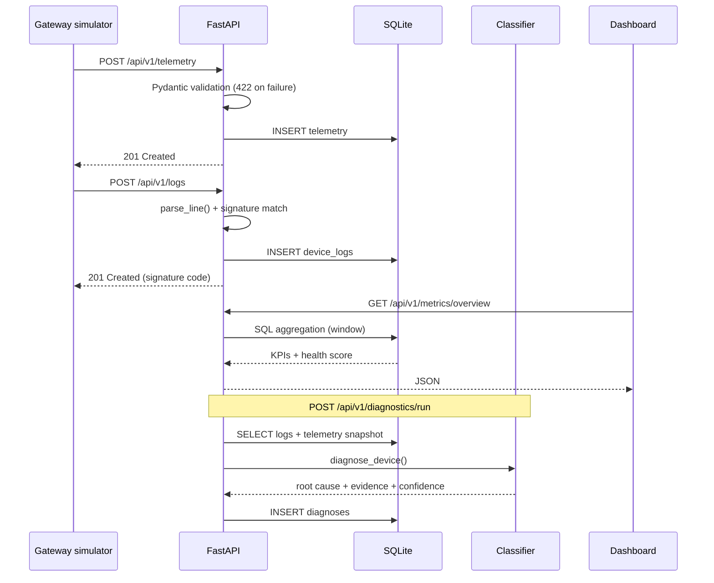

# Architecture

## Components

| Layer | Module | Responsibility |
|---|---|---|
| Simulation | `simulator.py` | Generates deterministic telemetry + syslog for 8 gateway profiles |
| Contracts | `models.py` | Pydantic schemas validate every ingest payload |
| Ingestion | `services.py` | Auto-registers devices, persists telemetry/logs |
| Parsing | `log_parser.py` | Syslog → structured fields → failure signature |
| Diagnosis | `diagnostics.py` | Weighted evidence → root cause, confidence, action |
| Storage | `repository.py`, `sql/` | SQLite schema, parameterised queries, aggregations |
| API | `api.py` | REST endpoints + OpenAPI docs |
| Presentation | `dashboard/` | Chart.js SPA polling JSON metrics |

## Request flow

## Design decisions

**Why SQL aggregation instead of Pandas?** The dashboard needs current-state
KPIs over a rolling window. Window functions (`ROW_NUMBER`) and conditional
aggregates express this directly, keep memory flat, and make the logic
auditable in `sql/kpi_queries.sql`.

**Why a rule engine?** For a portfolio-scale system, deterministic rules are
explainable: each diagnosis cites its evidence codes, which is exactly what an
on-call engineer needs. The scoring function is isolated so an ML model could
replace it later.

**Why canonical UTC strings?** Storing `YYYY-MM-DDTHH:MM:SSZ` makes SQLite
string comparison equivalent to chronological comparison, keeping window
filters correct with zero timezone ambiguity.

**Why auto-seed?** A reviewer cloning the repo should see a populated dashboard
on first `serve` without running data-prep steps. `--no-seed` disables it, and
tests pass `auto_seed=False`.

## Failure profiles

The simulator assigns profiles round-robin:

| Device | Profile | Injected behaviour |
|---|---|---|
| GW-001 | healthy | Baseline metrics |
| GW-002 | dns | DNS latency 500–6000 ms, SERVFAIL/timeouts |
| GW-003 | wan | WAN offline/degraded, packet loss, DHCP/PPPoE errors |
| GW-004 | memory | Memory 88–99 %, OOM, conntrack exhaustion |
| GW-005 | api | API latency 1–15 s, HTTP 5xx |
| GW-006 | wifi | Deauth floods, low RSSI, 25+ clients |
| GW-007 | firmware | CPU spikes, kernel panics, reboots |
| GW-008 | healthy | Baseline metrics |

Faults activate 40 % into the simulated window, so a 6-hour seed contains both
healthy and degraded periods.
